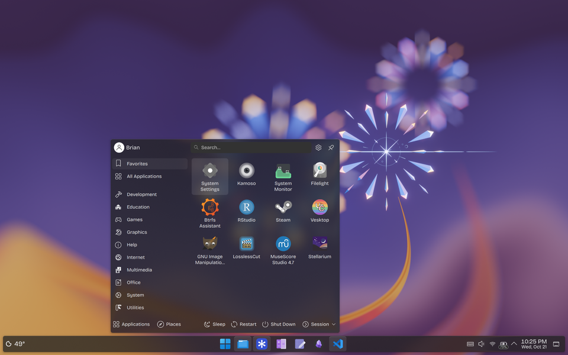

# Center Widget Popups

A KWin script for KDE Plasma 6 that horizontally centers any widget popup (e.g. Application Launcher) that opens within a user-defined horizontal range of the screen (default: 25%–50% from the left edge). Popups opening elsewhere stay where Plasma put them.

| Before | After |
| :---: | :---: |
|  |  |

## Installation

1. Download `center-widget-popups.kwinscript` from the [latest release](https://github.com/terminallywell/center-widget-popups/releases/latest).
2. In *System Settings* → *Window Management* → *KWin Scripts*, click *Install from File…* and choose the downloaded file.
3. Enable *Center Widget Popups* and click *Apply*. The target range can also be configured there.

To update, install the newer release the same way, then disable and re-enable the script.

To uninstall, remove it from the same KWin Scripts page.

## Limitations

- The script detects popups by screen position; any popup that opens from within the range is centered.
- Only the horizontal position changes.
- Untested with vertical panels and multiple monitors.

## License

[MIT](LICENSE)
