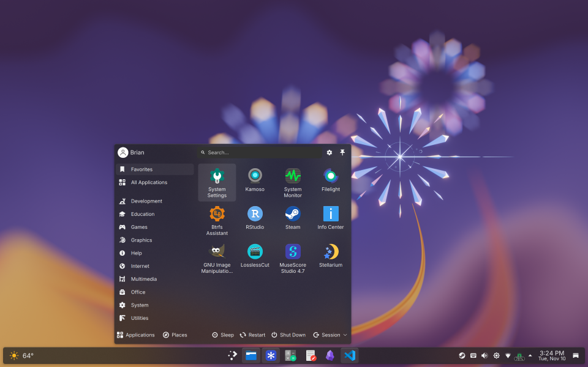
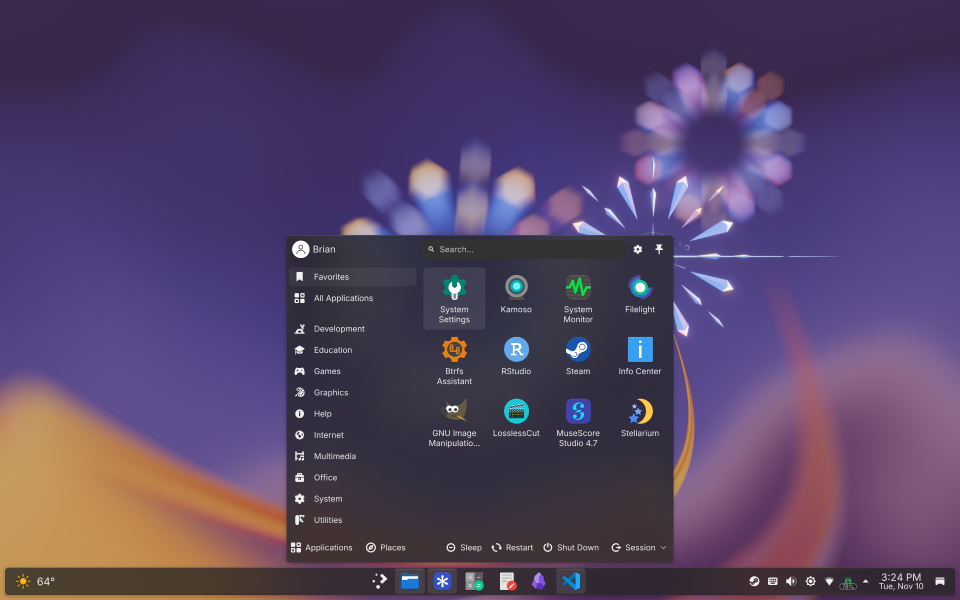

# Center Widget Popups

A KWin script for KDE Plasma 6 that horizontally centers any widget popup (e.g. Application Launcher) that opens within a user-defined horizontal range of the screen (default: 25%–50% from the left edge).

| Before | After |
| :---: | :---: |
|  |  |

## Installation

1. Open *System Settings* → *Window Management* → *KWin Scripts* and install the script in one of two ways:
   - **KDE Store:** Click *Get New…*, search for "Center Widget Popups", and click *Install*.
   - **GitHub release:** Download `center-widget-popups.kwinscript` from the [latest release](https://github.com/terminallywell/center-widget-popups/releases/latest), click *Install from File…*, and select the downloaded file.
1. Enable *Center Widget Popups* and click *Apply*. The detection range can also be configured there.

To update, use *Get New…* (KDE Store) or install the newer release file the same way (GitHub), then disable and re-enable the script.

To uninstall, remove it from the KWin Scripts page.

## Limitations

- The script detects popups by screen position; any popup whose horizontal center falls within the range is centered.
- Untested with vertical panels or multiple monitors.

## AI Use Disclosure

The script's core logic was implemented by Claude Opus 5.5.
